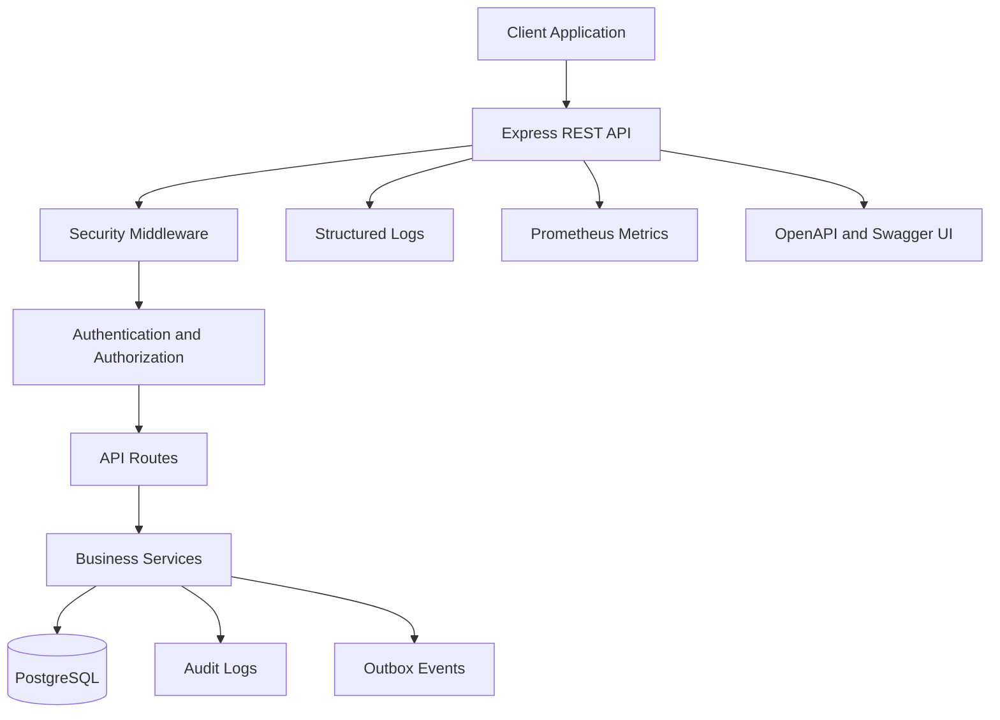
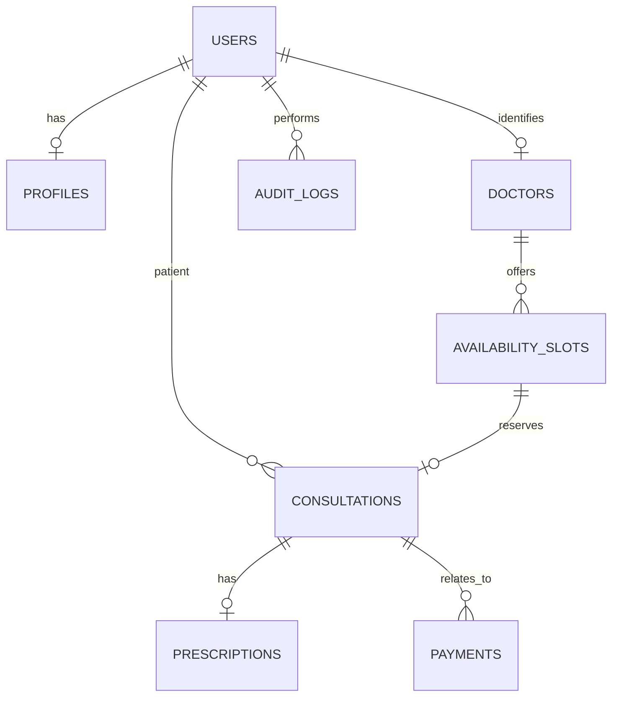
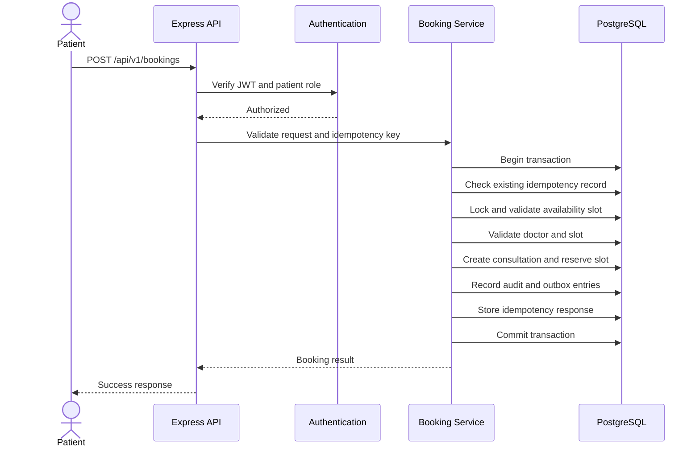

# Amrutam Telemedicine Backend — Architecture Document

## 1. Overview and Design Goals

The Amrutam Telemedicine Backend is a RESTful application built with Node.js, Express.js, and PostgreSQL. It supports patient authentication, doctor discovery, appointment booking, consultation lifecycle management, and prescriptions.

The design prioritizes data consistency during booking, controlled access to sensitive resources, modular code organization, and observability.

### Design goals

- Maintain consistency when multiple users attempt to book the same availability slot.
- Protect patient and consultation data through authentication and authorization.
- Provide retry-safe booking operations using idempotency keys.
- Record important business events for auditability.
- Support automated testing, continuous integration, and operational monitoring.
- Provide a path toward higher traffic without claiming unverified production capacity.

## 2. High-Level Architecture and Data Flow

The application uses a modular monolithic architecture. A single Express application exposes REST endpoints and separates routing, middleware, business logic, and database access.

### Component responsibilities

- **Express API:** Receives requests and returns HTTP responses.
- **Security middleware:** Applies HTTP security headers, CORS rules, request-size limits, and rate limiting.
- **Authentication and authorization:** Verifies JWTs and restricts operations by role and resource ownership.
- **Routes and services:** Implement API operations and enforce business rules.
- **PostgreSQL:** Stores users, doctor information, availability, consultations, prescriptions, audit records, idempotency records, and outbox events.
- **Observability:** Pino records structured request logs, while Prometheus metrics capture HTTP request counts and durations.
- **API documentation:** OpenAPI describes API operations and Swagger UI provides an interactive documentation interface.

The current design is a modular monolith, not a collection of independently deployed microservices. This keeps deployment and transactional behavior relatively simple while leaving room for later extraction of asynchronous workers or other services.

## 3. Core Data Model

The PostgreSQL schema contains the following principal entities.

| Entity | Purpose |
|---|---|
| `users` | Authentication identity and user role |
| `profiles` | Additional user profile information |
| `doctors` | Doctor-specific information |
| `availability_slots` | Appointment availability |
| `consultations` | Patient appointments and lifecycle state |
| `prescriptions` | Prescription records associated with consultations |
| `payments` | Payment-related records |
| `audit_logs` | Records of important business actions |
| `idempotency_keys` | Records used to recognize repeated write requests |
| `outbox_events` | Records of events intended for subsequent processing |

### Entity relationship diagram

The following diagram represents the conceptual relationships. Exact foreign-key constraints and cardinalities should be verified against `database/schema.sql`.

The `idempotency_keys` and `outbox_events` tables support request deduplication and event recording, respectively. Their precise relationships depend on the implemented schema.

## 4. Booking Flow and Concurrency Control

Booking is a critical workflow because concurrent requests must not reserve the same availability slot.

### Booking sequence

The sequence illustrates the intended transaction flow. The actual ordering and SQL operations must remain consistent with the implementation in `src/services/booking.service.js`.

### Transaction management

The booking service uses a PostgreSQL transaction to coordinate related database changes. Slot locking helps prevent concurrent requests from reserving the same slot. The transaction ensures that related changes commit together or are rolled back together when a failure occurs.

The application also records idempotency information so that retries can be recognized. Reusing an idempotency key with a different request payload should be rejected.

**Important implementation detail:** Idempotency behavior, locking, unique constraints, and rollback paths must be tested together. These controls reduce duplicate bookings and conflicting updates but do not eliminate the need for concurrency testing.

### Retry and backoff strategy

Clients and future background workers should use bounded retries for transient failures, such as temporary connection errors or selected transient server responses.

Recommended policy:

1. Retry only failures considered transient.
2. Use exponential backoff with random jitter.
3. Set a maximum retry count and total time budget.
4. Reuse the same idempotency key when retrying a booking request.
5. Do not automatically retry validation failures, authorization failures, or other permanent errors.
6. Handle PostgreSQL deadlocks or serialization failures only through a controlled retry of the complete transaction when safe.

A client timeout does not necessarily mean the transaction failed. The client should retry with the same idempotency key to avoid unintentionally creating a second booking.

This section describes the recommended policy; it does not claim that a generalized retry framework is already implemented.

## 5. Transactions, Events, and Sagas

The current booking workflow uses a local PostgreSQL transaction to coordinate consultation creation, slot reservation, and associated records.

The schema also includes an `outbox_events` table. An outbox pattern can reliably record an event in the same transaction as the business change, after which a separate worker publishes or processes it.

A complete transactional outbox requires additional behavior, including a publisher, retry handling, duplicate-delivery protection, and monitoring. The presence of the table alone does not establish that this processing pipeline exists.

A distributed saga is not required for the current single-database booking transaction. If future workflows span independent services, such as booking, payment, and notifications, a saga with explicit compensating actions may be appropriate. Those distributed workflows are proposed extensions rather than confirmed current functionality.

## 6. Search, Caching, and Data Partitioning

### Search and query optimization

Doctor discovery supports filtering and pagination. PostgreSQL indexes should be selected according to actual filter conditions, join patterns, ordering, and measured query performance.

Before introducing additional infrastructure, review query plans with `EXPLAIN ANALYZE` against representative data and verify that indexes support the most frequently used queries.

### Caching strategy

The current implementation should be treated as PostgreSQL-backed unless a cache has been separately implemented and verified.

For a larger deployment, a cache such as Redis could be considered for frequently read, relatively stable doctor-directory information. Availability and booking decisions must still be validated against authoritative database state.

If caching is introduced, define expiration, invalidation, stale-data behavior, and failure handling. A cache must not become the source of truth for appointment reservation.

### Data partitioning

Partitioning is not automatically required just because the target is 100,000 daily consultations. First measure table growth, query latency, index size, and maintenance overhead.

If consultation or audit data becomes large enough to justify partitioning, time-based partitioning may be evaluated for suitable tables. The migration plan must account for indexes, uniqueness constraints, foreign keys, retention policies, and operational maintenance.

Partitioning is a future scaling option, not a verified property of the current schema.

## 7. Security and Data Protection

The application includes JWT authentication, role-based access control, password hashing with bcrypt, Helmet, configurable CORS, request-size limits, rate limiting, and selected sensitive-header redaction in HTTP logs.

Parameterized SQL queries and resource-ownership checks help reduce injection and unauthorized-access risks where correctly applied.

Production deployment should additionally verify:

- HTTPS for data in transit.
- Encryption at rest for database storage and backups.
- Strong secret generation, restricted access, and key rotation.
- MFA for applicable accounts and administrative operations.
- Least-privilege database credentials.
- Authorization checks for every protected resource.
- Restricted access to audit logs and monitoring endpoints.
- Dependency vulnerability scanning and timely security updates.
- Appropriate privacy, retention, and deletion policies for sensitive medical data.

Password hashing protects stored passwords; it does not replace encryption of other sensitive data. Likewise, JWT authentication alone does not provide MFA.

Detailed threats and mitigation requirements are documented in `SECURITY.md`.

## 8. Observability and Operations

The application uses Pino HTTP logging and Prometheus metrics. The `/metrics` endpoint exposes application and Node.js metrics, including request counts and duration observations. Access to metrics should be restricted in production.

The `/health/live` endpoint provides a basic liveness check. A separate readiness check would be useful to determine whether the application is ready to receive traffic, including whether required dependencies are available.

Distributed tracing is a future improvement. OpenTelemetry or an equivalent tracing system could correlate requests across application components and future asynchronous workers.

Production monitoring should include:

- Request rate, error rate, and latency percentiles.
- Database connection pool utilization and query latency.
- Booking conflicts, failed transactions, and idempotency conflicts.
- Resource utilization and dependency health.
- Alerts for sustained failures and latency regressions.

Metrics and logs are implemented; distributed tracing, operational alerting, and production monitoring have not been established by the current test results.

## 9. Scalability, Availability, and Infrastructure

The system target is 100,000 daily consultations, p95 read latency below 200 ms, p95 write latency below 500 ms, and 99.95% availability.

These are design objectives, not measured achievements.

A production scaling plan would include:

- Stateless API instances behind a load balancer.
- Connection-pool sizing based on the database and deployment topology.
- Query optimization and representative load testing.
- Capacity planning for peak concurrent booking traffic.
- Controlled migrations and automated deployment checks.
- Database monitoring, backups, and tested recovery procedures.
- Redundant infrastructure and failure handling appropriate to the required availability objective.

The repository includes Docker and Docker Compose configuration, but containerized deployment must be tested before it can be considered verified. GitHub Actions currently validates the automated tests in its configured CI environment; a complete continuous deployment pipeline has not been confirmed.

## 10. Backup and Disaster Recovery

A production deployment should establish a documented recovery process.

Recommended measures:

1. Schedule automated database backups.
2. Use point-in-time recovery where supported and required.
3. Store backups separately from the primary database environment.
4. Encrypt backups and restrict access to them.
5. Define recovery point objective (RPO) and recovery time objective (RTO).
6. Perform periodic restoration drills.
7. Document incident response, recovery ownership, and post-recovery validation.

RPO defines the acceptable amount of data loss measured in time; RTO defines the target time to restore service. Their actual values must be agreed upon based on business requirements.

Backups, restoration drills, and a disaster recovery environment must be configured and tested separately; they are not proven by application unit tests.

## 11. Testing and Validation

The repository includes Jest and Supertest tests for health checks, database configuration, doctor endpoints, booking behavior, consultation lifecycle rules, and metrics.

GitHub Actions initializes a PostgreSQL test database and runs the test suite. A passing CI run confirms that the tests included in that workflow passed in that environment.

Before production deployment, further validation should include:

- Concurrent booking tests.
- Authorization and resource-ownership tests.
- Failure and rollback tests.
- Representative load and latency tests.
- Dependency vulnerability checks.
- Container build and startup verification.
- Backup restoration and recovery drills.

## 12. Conclusion

The current implementation provides a modular REST backend with core telemedicine workflows, PostgreSQL-based booking consistency, idempotency handling, security middleware, audit records, API documentation, automated tests, and basic observability.

Redis caching, distributed tracing, MFA, a full outbox-processing worker, distributed sagas, production load testing, and disaster recovery remain areas to implement or verify as required.

The design provides a foundation for further hardening and scaling, but production readiness and the stated performance and availability targets must be demonstrated through deployment, security review, load testing, and operational validation.
